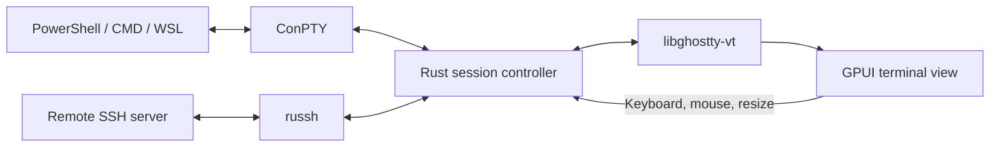

# Ghostlink implementation plan

Date: 2026-10-30

Status: A saved-connection picker opens at startup and for new SSH sessions, with search, add/edit/delete, and persistent named destinations. SSH sessions own their tabs and split panes, with automatic config/key discovery and shared authenticated connections. Scrollback selection, wrap-aware copying, terminal mouse reporting, and reconnect with retained output are implemented. Real Neovim and tmux checks pass through WSL. Local shell UI is deferred. The integration prototype remains open for live external-server compatibility, native pointer/IME validation, and accessibility. See [implementation progress](implementation-progress.md).

## Product direction

Build **Ghostlink as a Windows-first SSH workspace using Rust, GPUI, and libghostty-vt**. The primary workflow is connecting to remote servers and moving between related shells. The sidebar represents open SSH sessions. Each session owns its tabs and split layouts; changing sidebar selection restores that session's selected tab and focused pane. New tabs and splits use the current session's authenticated connection. Local shell UI is deferred while this SSH workflow is refined.

“Shell” means a terminal application that hosts PowerShell, Command Prompt, WSL, and other installed shells, rather than a new shell language. This is a greenfield project.

## 1. Architecture and responsibilities

- **Rust** owns application state, sessions, Windows integration, and networking.
- **GPUI** owns windows, interface controls, input handling, and GPU drawing.
- **libghostty-vt** owns terminal parsing and state: the screen, cursor, scrollback, modes, and terminal input encoding.
- **ConPTY** connects local Windows processes.
- **russh** provides direct SSH connections.

libghostty-vt supports Windows, but supplies no windowing or renderer drawing code. Build a terminal view in GPUI that paints libghostty’s state. Both libghostty’s API and GPUI are evolving, so pin tested revisions. See the [Ghostling architecture](https://github.com/ghostty-org/ghostling) and [GPUI documentation](https://github.com/zed-industries/zed/blob/main/crates/gpui/README.md).

GPUI already has a Windows backend using Win32, DirectWrite, and DirectX. Build on that rendering infrastructure. See the [GPUI Windows backend](https://github.com/zed-industries/zed/tree/main/crates/gpui_windows).

## 2. Visual design and interaction

Choose pragmatic defaults and resolve routine details automatically. Every new button or option should earn its place by serving a meaningful user decision. Prefer a direct path to the task, revealing prompts only when information is needed. For SSH, one destination resolves existing config and identities without an authentication selector or key-file picker.

The proposed direction is **quiet, precise, and tactile**:

- Graphite dark and warm light themes, with a restrained accent color.
- Excellent typography, carefully tuned terminal spacing, and crisp rendering at different display scales.
- A compact tab strip for the active session, a collapsible open-session sidebar, and a generous terminal canvas.
- Clear active-pane focus and persistent host identity, especially for production machines.
- Subtle transitions for tabs, panels, and dialogs, with reduced-motion support.
- A command palette that makes hosts, profiles, workspaces, and actions searchable.
- Useful empty states and connection errors that explain the next action.

Three interactions should define the product:

1. **Connect and work:** choose a saved connection or add a hostname or alias, authenticate, and start working.
2. **Stay grouped:** open related shells as tabs or splits in the current SSH session, and switch servers through the sidebar.
3. **Resume a workspace:** restore a named arrangement of SSH sessions, tabs, and panes.

Create visual prototypes for the main workspace, host picker, connection flow, and settings. Validate these inside GPUI early so the design reflects real text rendering and interaction behavior.

## 3. Integration prototype

The first technical milestone is a small working SSH workspace with independent remote shells grouped into session tabs and panes. The existing local terminal backend remains available for testing and later product work.

It must demonstrate:

- A reproducible Windows build of Rust, GPUI, and pinned libghostty.
- A narrow, safe Rust wrapper around libghostty’s C API.
- SSH session navigation with related tabs and independent PTYs on a shared authenticated connection.
- A direct SSH channel feeding the same terminal core.
- Correct resizing, keyboard input, scrolling, selection, and copying.
- Unicode, emoji, combining characters, and double-width characters.
- Japanese or Chinese IME composition and candidate positioning.
- A preliminary screen-reader path for terminal text.

**Exit criterion:** use a remote shell and a full-screen application such as Neovim, switching session tabs and panes without broken input, rendering, or resizing.

This prototype decides whether GPUI’s existing text APIs meet the terminal’s needs and identifies any upstream work before the product grows.

## 4. Core components and data flow

Keep the core small and independently testable.

| Component | Responsibility |
|---|---|
| `ghostty-sys` | C bindings and native-library linking |
| `terminal-core` | Safe terminal ownership, input encoding, snapshots, and resizing |
| `terminal-view` | GPUI painting, selection, hit testing, IME, and accessibility |
| `session` | Local and SSH lifecycle, transport events, cancellation, and reconnect |
| `app` | Tabs, panes, hosts, workspaces, settings, and Windows integration |

Each session should have one owner of its libghostty state. Background workers handle blocking process I/O and SSH networking; GPUI receives render snapshots without waiting on them.

Use bounded queues and backpressure for output. Coalesce rendering updates while preserving every terminal byte. ConPTY’s read/write and shutdown handling deserve particular care because Microsoft documents deadlock risks when channels are serviced incorrectly. See [ConPTY guidance](https://learn.microsoft.com/en-us/windows/console/creating-a-pseudoconsole-session).

For rendering:

- Paint visible rows through a custom GPUI element.
- Cache shaped text and invalidate affected rows.
- Keep libghostty’s cell positions authoritative.
- Preserve cell alignment through font fallback and ligatures.
- Route terminal-generated replies back through the session transport.

## 5. SSH experience

Use **russh for managed connections**, subject to the initial compatibility prototype. Its direct channel API gives the application structured authentication and connection events, while keeping remote terminal traffic independent of local ConPTY. It also exposes Windows named-pipe agent support. See [russh](https://github.com/Eugeny/russh) and its [Windows agent API](https://docs.rs/russh/latest/src/russh/keys/agent/client.rs.html).

The first release should support:

- Saved hosts with folders, tags, favorites, and recent connections.
- Password, private-key, agent, and keyboard-interactive authentication.
- Explicit first-use host-key verification and blocking on unexpected key changes.
- Jump hosts, keepalives, remote resizing, and clear disconnect handling.
- Import of a documented subset of SSH configuration.
- Reconnect that preserves the previous terminal view.

Treat full OpenSSH configuration compatibility as a separate feature. Unsupported directives should be visible; an OpenSSH-backed compatibility mode can follow if needed.

Keep secrets out of workspace files and logs. Prefer agent-held keys; use Windows credential storage for any explicitly saved secrets.

Workspace restoration should restore layout and connection definitions. Surviving remote processes requires something such as tmux; reconnecting alone cannot restore them.

## 6. Release scope

Scope the first release around daily use.

| First release | Follow-on work |
|---|---|
| SSH sessions with related tabs and shared connections | PowerShell, CMD, and WSL launch profiles; additional platform support |
| Tabs, splits, pane zoom, keyboard navigation | Advanced window and pane arrangements |
| Search, selection, hyperlinks, configurable scrollback | Rich terminal graphics |
| Saved SSH hosts and authentication | Integrated SFTP browser |
| Command palette and editable keybindings | Snippets and automation |
| Named workspaces and layout recovery | Remote session persistence integration |
| Light/dark themes and font controls | Theme marketplace |
| Accessible controls and terminal text | Additional accessibility refinements |

Shell integration can later add working-directory tracking, command completion indicators, and command navigation. Build these from explicit shell integration signals rather than guessing from displayed text.

## 7. Delivery milestones

These are planning estimates for **two experienced engineers with part-time design support**, to be revised after the prototype.

| Phase | Estimate | Completion gate |
|---|---:|---|
| Product direction | 1 week | Visual direction, interaction flows, supported-platform policy |
| Integration prototype | 2–3 weeks | Local and SSH terminals work correctly inside GPUI |
| Daily-use terminal | 3–5 weeks | Tabs, splits, search, clipboard, input, and shell profiles |
| SSH experience | 3–4 weeks | Authentication, trust, hosts, jumps, and reconnect |
| Workspace polish | 2–3 weeks | Palette, restoration, themes, and consistent interactions |
| Beta hardening | 3–4 weeks | Accessibility, performance, installer, upgrades, and compatibility |

This suggests **roughly 14–20 weeks to a usable beta**, with public-release timing driven by compatibility testing.

## 8. Performance and release validation

Typing latency is the current priority. The first measured fix reduced dense-viewport terminal paint work from approximately 200 ms to 3–4 ms in the existing development build. See [performance measurements](performance.md) for the probe, transport results, and remaining validation limits.

Set provisional performance targets on a documented reference PC:

- Application window visible within 750 ms.
- Near-zero idle CPU.
- Smooth terminal interaction during heavy output.
- Measure shell startup separately from application startup.

Release validation should cover:

- PowerShell, WSL, SSH, tmux, and Neovim.
- Large output streams.
- Mixed-DPI monitors.
- Non-US keyboards and IME.
- Screen readers and keyboard-only navigation.
- Sleep/resume and network interruptions.
- GPU recovery.

Use recorded terminal streams for repeatable correctness and rendering checks, plus Windows CI and clean-machine installation tests.

## First build milestone

**A polished GPUI workspace with SSH sessions in the sidebar, related tabs and panes, and responsive libghostty-vt terminals.**

Current progress: the Windows build, safe libghostty wrapper, ConPTY backend, shared russh transports with independent PTYs, explicit host-key trust, SSH connection form, session sidebar, session-owned tabs, and nested split panes are implemented. Protocol and GPUI test-backend checks pass, and the user confirmed working external SSH and improved typing responsiveness. A live remote full-screen application, accessibility, and real Windows visual/IME validation remain before this milestone is complete.
